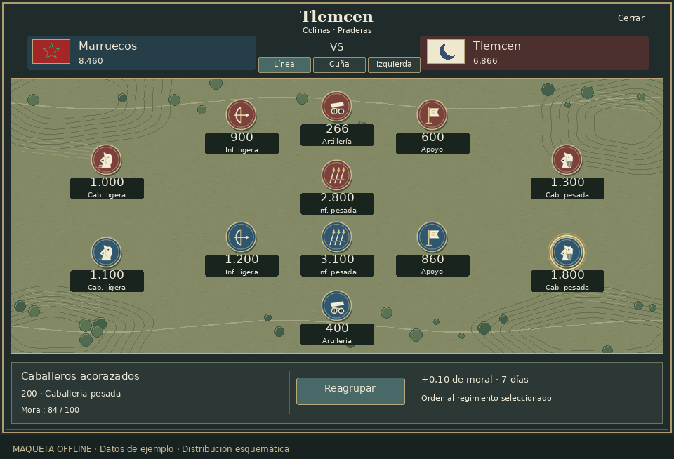

# Veni, Vidi, Vici — EU5

**Target: Europa Universalis V 1.4.x · Version: 0.2.0-alpha**

VVV aims to add a 2D command board opened **from the active battle window**.
Orders on the board act on the regiments participating in that battle; EU5's
normal battle view and native combat continue to exist.

This is an integration alpha. **The battle button, board opening and live troop
data have been confirmed by the player in EU5.** The redesigned 0.2 board and
rally order still need in-game validation. Static checks and installer tests
cannot establish rendering or combat behavior.

## Actualización 0.2: campo de batalla sin scroll

Ventana de 960×620, con el lugar de la batalla como título, los dos bandos con
sus banderas nativas y un fondo derivado del terreno de la localidad. Las
órdenes ocupan una franja inferior acotada. Se conservan los arreglos de
registro de la ventana y de captura del combate de la última actualización.

Las tropas se agrupan en seis fichas por bando: infantería ligera y pesada,
caballería ligera y pesada, artillería y apoyo. Cada ficha suma los efectivos
reales de su categoría y tiene un símbolo propio. No hay listas desplazables.
Los botones **Línea, Cuña e Izquierda** cambian la distribución visual propia.
Todavía no modifican las posiciones ni los cálculos del combate nativo.

Para actualizar: cierra EU5, descarga el ZIP nuevo, extráelo y vuelve a ejecutar
`Install-VVV.cmd` desde esa copia. Después reinicia el juego y comprueba el
encaje visual, las banderas, los totales y la selección.

## Qué incorpora esta primera versión

- Tipo de botón **Mando táctico** insertado en el contenido de la ventana de batalla.
- Panel 2D central, enemigo arriba y fuerzas propias abajo, leyendo el combate
  real capturado desde `BattleView.GetCombat`.
- Fichas por categoría con totales reales, iconos y detalles nativos al pasar
  el cursor; fondos de llanura, colinas, montaña, bosque, terreno seco y humedal.
- Al pulsar una ficha propia se elige un regimiento de esa categoría: primero
  uno con moral incompleta y disponible para Reagrupar; después uno herido o
  cualquier regimiento activo. Su nombre, tipo y moral aparecen abajo.
- Orden experimental **Reagrupar**: `+0,10` de moral al regimiento seleccionado,
  con recuperación de siete días por regimiento y validación de dueño,
  controlador, batalla y participación activa.
- Instalador que genera el enganche desde la interfaz de tu instalación.
  Los archivos de EU5 se leen; el resultado se escribe en la carpeta del mod.
- Español e inglés. Sin dependencias de otros mods.

**Todavía no incluye movimiento, orientación, cargas, envolvimientos, terreno
táctico funcional, doctrinas, rasgos nuevos ni IA de órdenes.** Las formaciones
son distribuciones esquemáticas, no posiciones militares simuladas. La orden
de moral es una prueba del enlace con el combate, no el sistema táctico final.
Las órdenes de esta alpha se desactivan en multijugador.

## Instalar y probar en Windows

1. Descarga este repositorio: **Code → Download ZIP** y extrae la carpeta.
2. Ten instalado **Python 3.10 o posterior**. No hacen falta librerías adicionales
   para instalar. Si tienes el lanzador `py`, el instalador lo utilizará.
3. Cierra EU5 y ejecuta **`Install-VVV.cmd`**. Busca Steam y sus bibliotecas;
   si no encuentra EU5, permite seleccionar la carpeta de instalación.
4. Instala en `Documentos/Paradox Interactive/Europa Universalis V/mod/EU5-VVV`.
   El instalador consulta la ubicación real de Documentos en Windows, incluida
   su redirección a OneDrive.
5. Activa **Veni, Vidi, Vici — Tactical Command** en el gestor de mods y reinicia EU5.
6. En una partida de prueba individual, abre una batalla terrestre propia.
   Busca **Mando táctico** en la parte superior del contenido de su ventana.
7. Abre el tablero y selecciona una ficha azul. Comprueba el regimiento indicado
   abajo antes de pulsar **Reagrupar**. La orden afecta a ese regimiento, no a
   toda la categoría. Sigue [esta guía](docs/TESTING.md).

Si el marco muestra un aviso de datos pendientes, ciérralo y vuelve a abrirlo.
Si continúa, comparte el fragmento de `error.log` relacionado con VVV. En esta
versión el cierre del tablero es explícito, mediante su botón Cerrar.

Si no detecta tu juego, abre una terminal en esta carpeta y ejecuta:

```powershell
py -3 -m tools.install --game-dir "D:/SteamLibrary/steamapps/common/Europa Universalis V"
```

Si utilizas otra carpeta de mods, añade `--mod-dir "ruta/completa/EU5-VVV"`.
El instalador rechaza destinos que se solapen con el juego o con el repositorio.
Al actualizar, conserva una copia de la instalación anterior y se detiene si
detecta archivos del mod editados por el usuario.

Vuelve a ejecutar el instalador después de actualizar EU5. El override generado
de `battle_lateralview.gui` es específico de tus archivos. Otros mods que cambien
esa misma interfaz necesitarán una integración conjunta.

## Vista previa del diseño



La imagen muestra el diseño y las dimensiones previstos. Usa datos de ejemplo
y fuentes aproximadas. El render real, el tamaño de los widgets y su encaje
todavía deben verificarse en el juego.

## Desarrollo

```bash
python -m tools.validate
python -m unittest discover -s tests -v
python -m tools.package
```

Para regenerar las texturas originales y la maqueta:

```bash
python -m pip install "Pillow>=11.3"
python -m tools.generate_gui
python -m tools.build_battlefield_art --preview
```

El plano compartido está en `design/battlefield.json`; genera la GUI después
de cambiarlo. Pillow solo se necesita para regenerar los dibujos y maquetas.

Python es una herramienta de instalación y desarrollo; no se ejecuta dentro de
EU5. Los cambios de juego se implementan con GUI y scripts nativos de EU5.

Consulta [arquitectura y límites](docs/ARCHITECTURE.md), [pruebas en juego](docs/TESTING.md),
[siguientes hitos](docs/ROADMAP.md) y [referencias técnicas](docs/REFERENCES.md).
